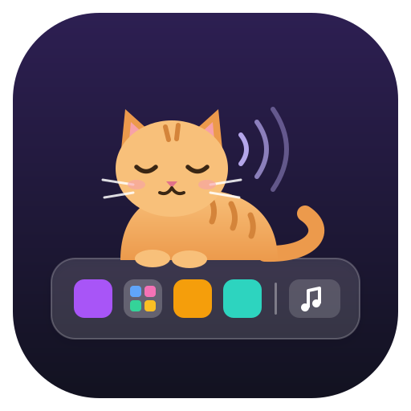

<p align="center"></p>

<h1 align="center">Dockrr</h1>

<p align="center">
  Folders, the song playing now, and icons that stay yours,
  for <a href="https://github.com/micheleg/dash-to-dock">Dash to Dock</a> on GNOME 48.
</p>

<table>
  <tr>
    <td align="center"></td>
    <td align="center"></td>
  </tr>
  <tr>
    <td align="center">Dock on the left</td>
    <td align="center">Dock at the bottom</td>
  </tr>
</table>

- **Folders in the dock.** GNOME's own app folders become dock icons. Click
  one, and its apps open in a pop-up grid, with unread badges and running
  indicators.
- **The song playing now.** A card at the dock's end shows the cover, title
  and artist, with previous, play/pause and next buttons. It is tinted by
  the cover.
- **Your own app icons.** Pick a picture from an app's right-click menu, or
  list it in a file. The icon survives app updates and renames.

Dash to Dock can't hold folders itself. The extension that pinned folders
to GNOME's dash supports GNOME 43 only.

## Install

Requirements:

| | Tested on |
|---|---|
| OS | Debian 13 (trixie) |
| GNOME Shell | 48 (48.7), X11 session |
| Dash to Dock | version 100 (Debian's `gnome-shell-extension-dashtodock`) |

```sh
make install
gnome-extensions enable dockrr@psouranis.github.io
```

Then log in again. On X11, Alt+F2, `r`, Enter is enough.

### Without Dash to Dock

Folders, the song card, and the right-click menu items all live inside
Dash to Dock, so they need it. Without Dash to Dock, only
[`launchers.json`](#icons-and-window-classes-from-a-file) works: its icons
and window classes still apply everywhere (Show Apps, Alt+Tab, GNOME's own
dash).

## Quick start

1. Make a folder: right-click an app in the dock, then **Add to Folder** →
   **New Folder…**. Or, in Show Apps, drop one app on another.
2. Put it in the dock: right-click a dock folder → **Dockrr Settings**, or
   open the Extensions app → Dockrr → settings, and switch it on.
3. Drag it to where you want it.

A folder's name and apps are always the app folder's own, read live. Change
the folder in Show Apps, and the dock follows.

## Folders

- **The icon.** A rounded square shows the folder's first four apps. Click
  it, and its apps open in a pop-up grid, each with its name. Click an app
  to open it, or to bring its window forward.
- **App menus.** Right-click an app in the pop-up for its own menu, as on
  the dock: its windows, New Window, its actions, Pin to Dock, App Details,
  Quit. Esc, or a click elsewhere, goes back to the folder. New Window is
  left out for apps that only ever have one window (Signal, Discord, Slack,
  and any app for which it opened nothing).
- **Running indicators.** Dash to Dock's own: on the folder while one of
  its apps is open, and on each open app in the pop-up. They use whatever
  style Dash to Dock is set to (dots, dashes, segments...), and change with
  it.
- **Unread badges.** Red counts at the icon's top right, as on the dock's
  other icons: on each app in the pop-up, and their total on the folder.
  They are Dash to Dock's own counts: the app's launcher count (Signal,
  Slack, Discord and others set one) plus its GNOME notifications. An app
  that sets its own count is counted by that alone. A leftover notification,
  posted before an update restarted the app, can't leave a stuck "1".
- **Fewer dock icons.** An app in a dock folder gets no dock icon of its
  own while it runs. The folder stands for it.
- **Drop apps in, drag them out.** Drag an app icon from the dock (or Show
  Apps) onto the folder. The folder lights up, and on release the app goes
  in: it is added to the app folder, taken out of any other, and unpinned
  from the dock. Drag an app out of the pop-up and let go anywhere but the
  folder: it leaves the folder, unpinned, as a plain app.
- **Make folders from the dock.** Right-click an app in the dock → **Add to
  Folder** → one of the dock's folders, or **New Folder…**. Name it, and a
  folder with that app takes the app's place in the dock.
- **Move it.** Drag the folder along the dock. A gap opens where it will go,
  between any two icons, and it goes there when you let go. Esc, or letting
  go off the dock, leaves it where it was.
- **Folder menu.** Right-click a folder: Rename…, Move Left, Move Right,
  Remove from Dock, Dockrr Settings.
- **Any folder.** The settings window (the Extensions app, or right-click a
  dock folder) has a switch per app folder.

## The song playing now

- **Where.** A card of its own at the dock's end, never among the apps and
  folders. In a dock spanning the screen, it sits at the far end.
- **What.** The album cover, the title and artist, and **previous /
  play-pause / next**.
- **Look.** The card is tinted with the cover's main colour, changing with
  each song. A hairline along its bottom fills as the song plays. A long
  title scrolls slowly back and forth, and a new song fades in. The card has
  one fixed width, so it never shifts along the dock.
- **Cover click.** Click the cover to bring the player to the front. Click
  it again to minimize the player, as the dock's own icons do.
- **When.** Only while something plays or is paused.
- **Which players.** Any app with MPRIS works (Supersonic, Spotify, a
  browser playing a video): the same players GNOME's clock menu shows.
- **Privacy.** A cover is shown only from a local file, so the dock never
  fetches one over the network.
- **Side docks.** In a dock on the left or right, the buttons stack and the
  text is left out.

## Your own app icons

Right-click an app, in the dock or in a folder's pop-up → **Change Icon…**,
and pick a picture (PNG, SVG, JPEG...). It becomes the app's icon
everywhere: the dock, folders, Show Apps, Alt+Tab. **Reset Icon** takes it
back.

How it works: Dockrr writes a copy of the app's `.desktop` file to
`~/.local/share/applications`. It makes the copy again from the app's own
file whenever apps change, so an update's other changes still come
through, with your icon. The copy is removed if the app is uninstalled.
Contents are compared, not dates: dpkg keeps a package's own file dates,
so an updated launcher can look older than the copy.

### Icons and window classes from a file

For a setup kept in a repo, list them in `~/.config/dockrr/launchers.json`.
Dockrr reads it live:

```json
{"launchers": [
  {"ids": ["com.microsoft.VSCode", "code"], "icon": "/home/you/.local/share/icons/code.png"},
  {"ids": ["org.signal.Signal"], "wmclass": "org.signal.Signal"},
  {"ids": ["chrome-<app id>-Default"], "icon": "/path/to/web-app.png", "user_only": true}
]}
```

| Key | What it does |
|---|---|
| `ids` | Every name the app's launcher has had, newest first. When an update renames it (VS Code 1.143 went from `code` to `com.microsoft.VSCode`), the new one gets the icon, and a dock favourite on the old one moves to it. |
| `icon` | The picture to use. |
| `wmclass` | Sets `StartupWMClass`, for an app whose launcher names the wrong window class. Without it, the dock shows a second, generic icon for its windows. |
| `user_only` | For a launcher that exists only in `~/.local/share/applications`, like a Chromium web app's. It is edited in place, and again whenever Chromium rewrites it. |

A picture picked with Change Icon… wins over the file's, until Reset Icon.
Take an app off the list, and its copy goes, so its own icon is back.
