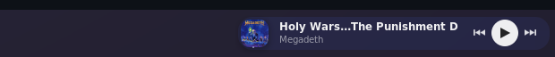

<p align="center"></p>

<h1 align="center">Dockrr</h1>

<p align="center">
  Folders, the song playing now, and icons that stay yours,
  for <a href="https://github.com/micheleg/dash-to-dock">Dash to Dock</a> on GNOME 48.
</p>

## Folders

GNOME's app folders become dock icons. Click one to open its apps in a
pop-up, with unread badges and running indicators. Drag apps in and out, and
move the folder along the dock.

<table>
  <tr>
    <td align="center"></td>
    <td align="center"></td>
  </tr>
</table>

## The song playing now

A card at the dock's end shows the song's cover, title and artist, with
previous, play/pause and next buttons. It takes its tint from the cover and
shows a progress line. Click the cover to show the player, and click it
again to hide it. It works with any MPRIS music player (Supersonic,
Spotify, ...). Videos playing in a web browser are left out.

<p align="center"></p>

## Your own app icons

Right-click an app → **Change Icon…** and pick a picture. The icon is used
everywhere, and it survives app updates and renames. **Reset Icon** undoes
it.

To keep icons in a repo instead, list them in
`~/.config/dockrr/launchers.json`:

```json
{"launchers": [
  {"ids": ["com.microsoft.VSCode", "code"], "icon": "/home/you/.local/share/icons/code.png"},
  {"ids": ["org.signal.Signal"], "wmclass": "org.signal.Signal"}
]}
```

`ids` lists the app's launcher names, newest first. `icon` sets the picture
and `wmclass` fixes a wrong window class. Add `user_only` for a launcher
that exists only in `~/.local/share/applications`.

## Install

Tested on Debian 13 with GNOME Shell 48 (X11) and Dash to Dock 100.

```sh
make install
gnome-extensions enable dockrr@psouranis.github.io
```

Log in again, or on X11 press Alt+F2, type `r` and press Enter. Then
right-click an app in the dock → **Add to Folder** → **New Folder…**.
